# Action2D -- BlueWitch

<figure>
  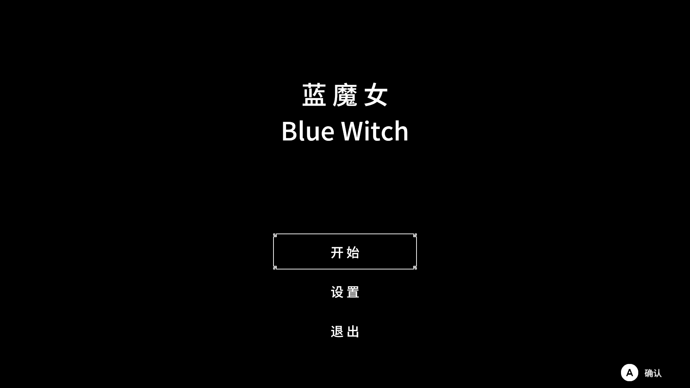
  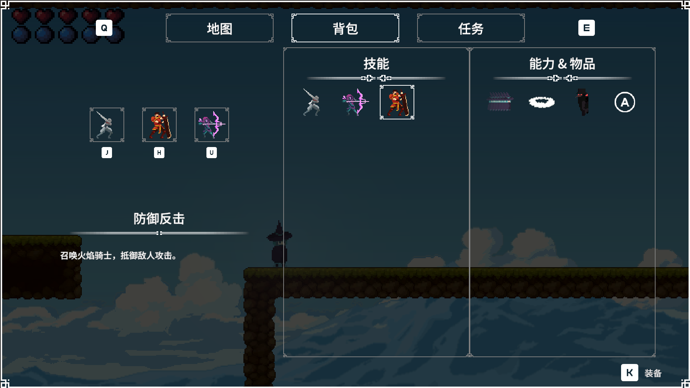
  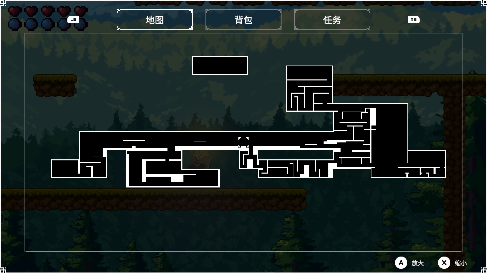
  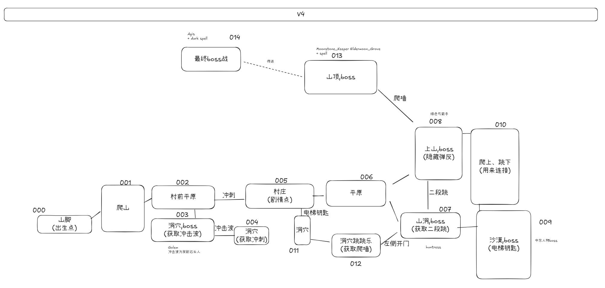
</figure>

一个较为完整的类银河恶魔城 Demo, 使用 Unity 引擎开发，包含了无缝地图、战斗系统、存档系统、怪物行为与AI、世界物品与机关交互、音乐音效播放、背包与技能配置、HUD与UI、多设备输入等功能。
游戏大体流程是主角从山脚区域诞生，首先获取基础的近战技能与冲刺能力后进入任务点村庄，从中接取任务分别前往山洞、地下、沙漠、山顶等区域获取相应的道具以及远程、防御反击、激光、冲刺、二段跳、爬墙、钩锁等技能和能力，最终开启最终boss祭坛传送至最终区域击败最终boss。

游戏拥有十多个相互连续的地图区域，主角在边界处移动自动切换。主角与怪物的基本行为如移动、战斗等由状态机实现，怪物AI由行为树实现。游戏的战斗系统实现了近战、远程、防御、反击、冲刺、碰撞等战斗方式。
主角在游玩过程中逐步获取多种技能和能力，目前以及实现的技能包括近战、远程、防御反击，能力包括冲刺、爬墙、二段跳，后续将继续实现更多的技能与能力。

### 无缝地图

无缝地图的实现基于预先保存的每块地图区域的预制件，当玩家处于地图区域边缘处或进行传送时借助 `Resources ` 异步加载与卸载。
地图 UI 的实现基于预先绘制的每块地图区域的图片，在运行时动态拼接 `Image` 组件，并适当计算位置映射。

<figure>
  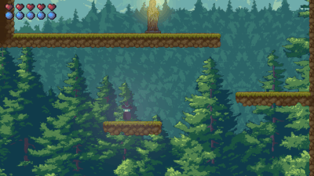
  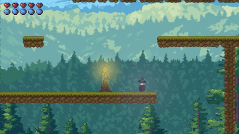
  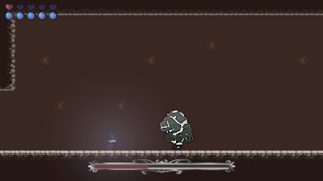
  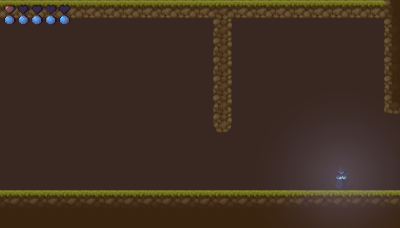
</figure>

### 战斗系统 & 技能

主角、怪物、投掷物等基于统一的基类 Entity，此类实现了基础的运动检测与执行。每个子类拥有各自的状态机以实现基础的行为动作与过渡，怪物还持有 `CharactorController` 子类来基于行为树实现 AI，玩家也利用自己的 `CharactorController` 子类来实现输入与动作的解耦。

战斗系统基于统一的 HitBox、DefendBox 及作为 HurtBox 的 Entity。HitBox 基于 Collider 进行判定，在适当时机计算攻击效果，生成攻击成功、攻击伤害、方向、受击点、类型等攻击信息传递回打击、受击方的回调函数。

角色技能的实现采用统一的技能基类 `Summon`, 角色进入技能状态时有参数指定具体技能，技能类基于 HitBox、DefendBox 对 Entity 产生作用。

<!-- [攻击击中] [防御反击] [碰撞伤害] [冲刺躲避] [陷阱] [Boss战开始] [Boss战结束] -->

<figure>
  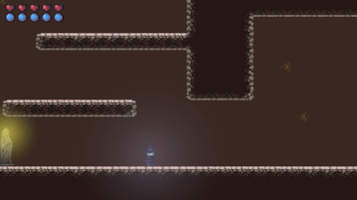
  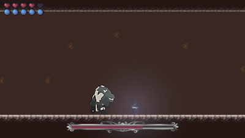
  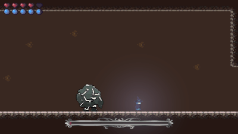
  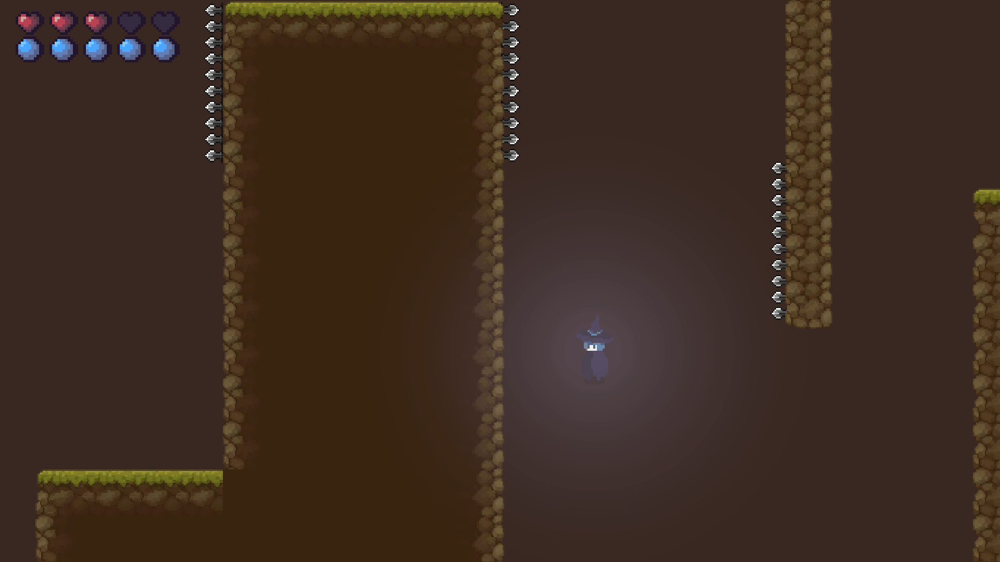
</figure>

### 背包 & 物品拾取 & 机关交互

背包中包含技能物品、能力物品和普通物品，可以在当前技能配置框或者技能物品框处执行技能配置的修改。技能物品、能力物品和普通物品均采用统一的物品 id，因而可以共同作为拾取物进行拾取，技能物品与能力物品在拾取时额外有改变角色对应布尔值的效果。

拾取物品与机关都基于统一的 `Interactive` 类，对于角色的交互行为无需具体分类。


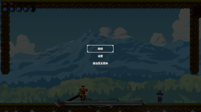

### 怪物 AI

怪物的行为与 AI 采用分层设计，状态机控制基础动作与基础过渡，行为树进行高级决策并影响状态机以影响基础动作。
最初采用自己编写的状态机和行为树进行怪物 AI 的实现，后来发现 Debug 过于繁琐，就将后来编写的怪物采用了 Canvas2D 的状态机和行为树。


<figure>
  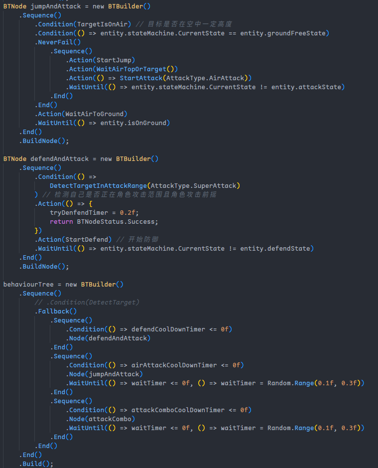
  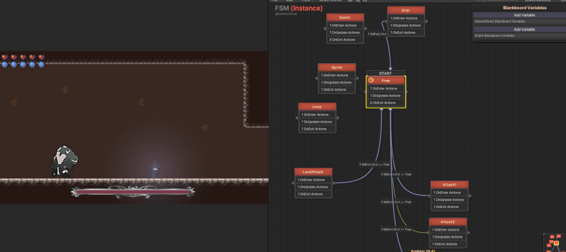
  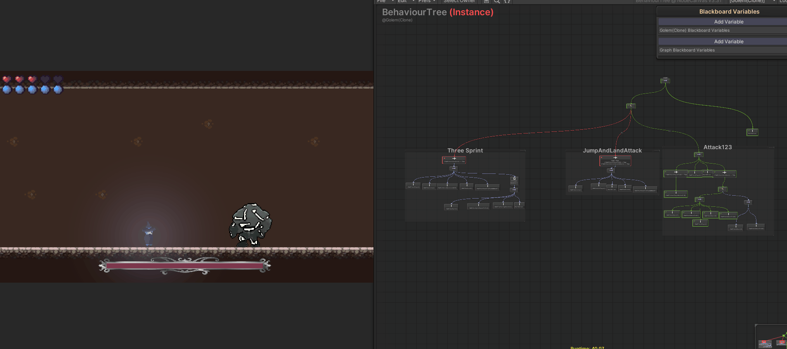
</figure>


### 存档设计

存档系统基于 Serializable 的数据对象进行 json 的序列化/反序列化。对于一个存档槽 `SaveSlot`，其包含角色数据 `player`、地图区域数据`levels`、存档点数据 `checkpoints`、动态生成的拾取物 `dynamicPickupItems` 等字段，对于非动态生成的拾取物与机关状态数据则储存在 `levels` 字段之内的具体地图数据中。

一个存档文件示例如下：
```json
{
    "player": {
        "maxHealth": 5.0,
        "maxMagic": 5.0,
        "money": 0,
        "ability": {
            "attack": true,
            "defend": true,
            "arrow": true,
            "dash": true,
            "doubleJump": true,
            "wallSlide": true
        },
        "checkpoint": "008",
        "controlConfig": {
            "attack1": "1000",
            "attack2": "1002",
            "attack3": "1001"
        },
        "inventory": [
            {
                "id": "0000",
                "quantity": 2
            }
        ]
    },
    "bosses": [
        {
            "id": "001",
            "dead": true
        },
        {
            "id": "002",
            "dead": false
        }
    ],
    "checkpoints": [],
    "levels": [
        {
            "id": "003",
            "open": true,
            "pickupItems": [
                {
                    "id": "000",
                    "picked": true
                },
                {
                    "id": "001",
                    "picked": false
                }
            ],
            "doors": [
                {
                    "id": "000",
                    "open": false
                },
                {
                    "id": "001",
                    "open": false
                }
            ]
        },
        {
            "id": "004",
            "open": true,
            "pickupItems": [
                {
                    "id": "000",
                    "picked": true
                }
            ],
            "doors": []
        },
    ]
}
```
